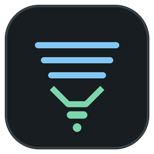
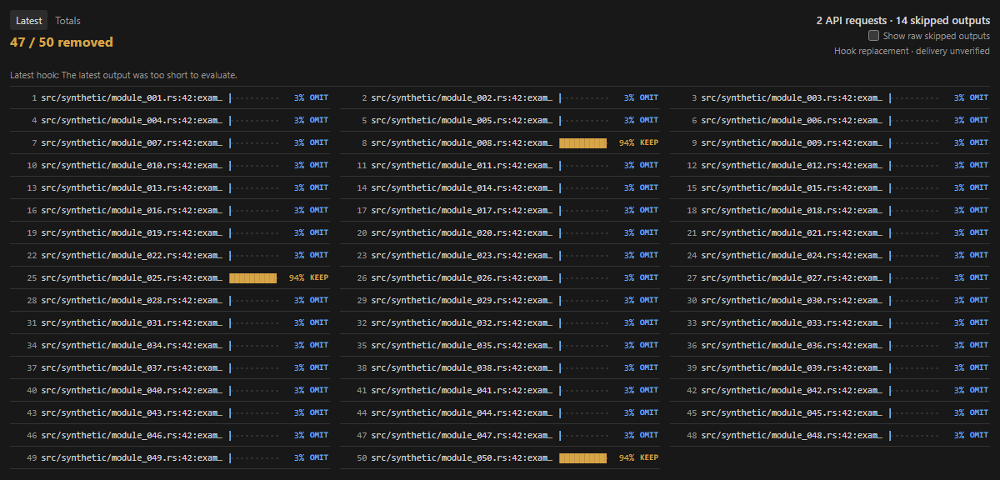

# Codex Decision



Codex Decision selects repetitive lines for removal from supported local tool output. Local safeguards keep diagnostics, exact source, exhaustive results, and completion evidence. Every shortened result links to its complete original.

**Codex Decision 0.17.0** — [Download the integrated VSIX](https://github.com/PhilippElhaus/Codex-Decision/releases/latest).

## Get started

Install the VSIX in **Visual Studio Code** through **Extensions → … → Install from VSIX…**, or run:

```bash
code --install-extension codex-decision-0.17.0.vsix --force
```

The package contains Windows and Linux x86_64 runtimes, session controls, settings, a panel, and a verified Codex UI patch. Native Windows needs no WSL or Python. The extension follows Codex's Windows/WSL execution setting. Each runtime retains its own plugin data and credentials.

Reload VS Code after integration repair. Review the **Codex Decision** hook definitions in `/hooks` when Codex requests trust. Select **OpenAI Decisions**, **TypeSafe Jev**, or a compatible **Custom provider** in **Connect Decision**. Test and save the connection. Credentials stay out of chat.

Click **decision** in the composer to change the current thread's enabled state. Open **Codex settings → Decision** to choose Monitor or Filter, adjust relevance, and manage retention. Open the **Decision** panel for Latest, Totals, or optional local skipped-output capture.



Use **Decision: Check Integration** for status and **Decision: Repair Integration** to retry installation or restore the panel. Unknown or modified Codex builds produce a diagnostic. Automatic updates check this repository's stable GitHub releases daily and verify package size and SHA-256 before installation.

A prepared replacement does not prove downstream context reduction or billed-token savings. Code-mode wrappers can still print an original nested tool result. See [measurement limits](docs/operations/measurement.md).

## Additional Decision tools

Run **Decision: Register MCP Tools in Codex** to add the native `rank_context`, `triage_failure`, and `verify_completion` tools. The companion also provides editor commands for each workflow and publishes failure reviews in Test Explorer. Scores remain advisory; function coverage selects tests.

Use **Decision: Show Usage Measurements** to compare observed Monitor/Filter token usage and inspect reported provider cache hits. Use **Decision: Configure Completion Verification** for opt-in Stop review. Observe reports unsupported claims. Enforce can request one continuation for an explicit contradiction. See [context ranking](docs/reference/context-ranking.md), [failure triage](docs/reference/failure-triage.md), and [completion verification](docs/reference/completion-verification.md).

## Documentation

Start with the [documentation index](docs/README.md). Direct guides:

- [Installation and recovery](docs/setup/installation.md)
- [Provider credentials and custom endpoints](docs/setup/providers.md)
- [Using the composer and panel](docs/reference/usage.md)
- [Configuration](docs/reference/configuration.md), [filtering](docs/reference/filtering.md), and [privacy](docs/reference/privacy.md)
- [Architecture](docs/architecture/overview.md)
- [Tests](tests/README.md), [Nx function-level TIA](docs/development/test-impact.md), and [package builds](docs/development/builds.md)

Development keeps native Cargo, Node's built-in runner, and Python unittest. Nx orchestrates tasks. Per-test function coverage selects low-level tests when evidence is valid. Missing or uncertain evidence runs the complete relevant suite. CI retains browser, Windows, interruption, provider-failure, and package gates.
