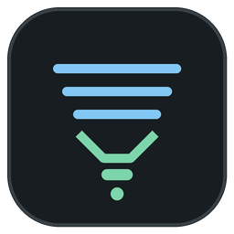
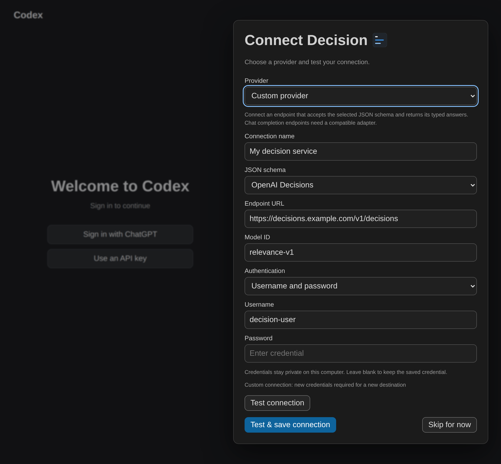
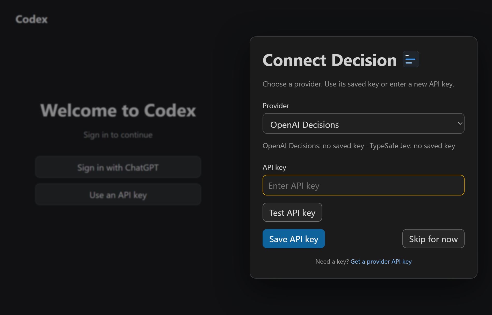
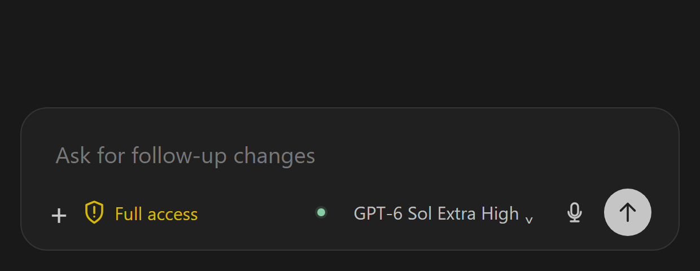
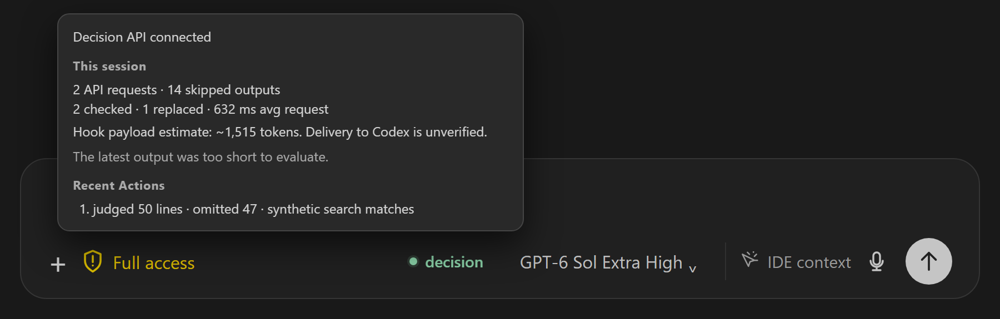
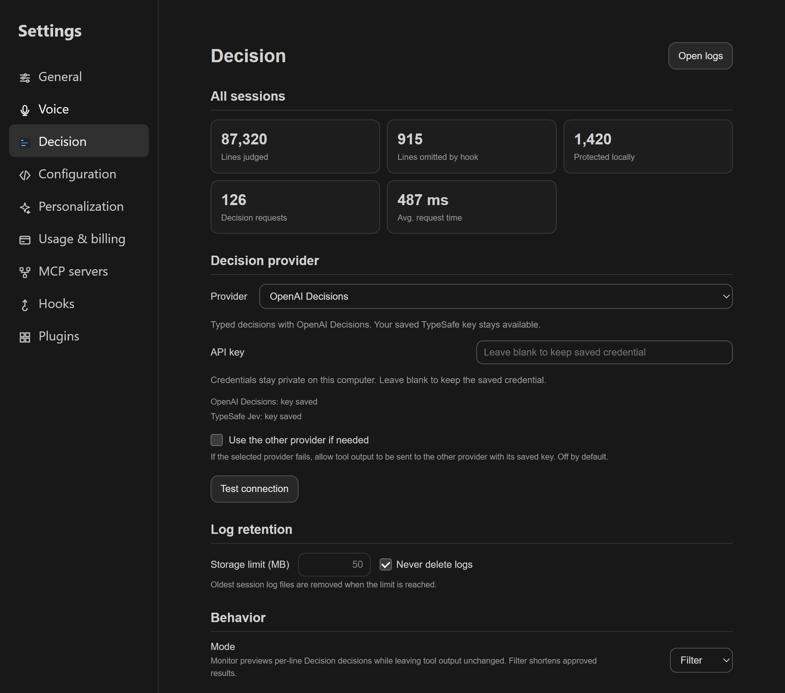
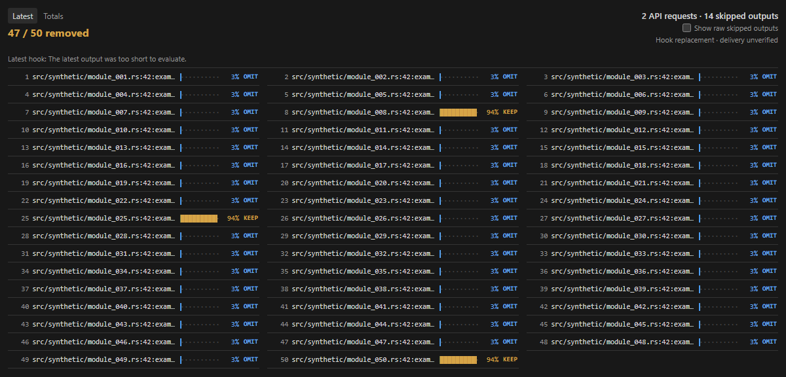
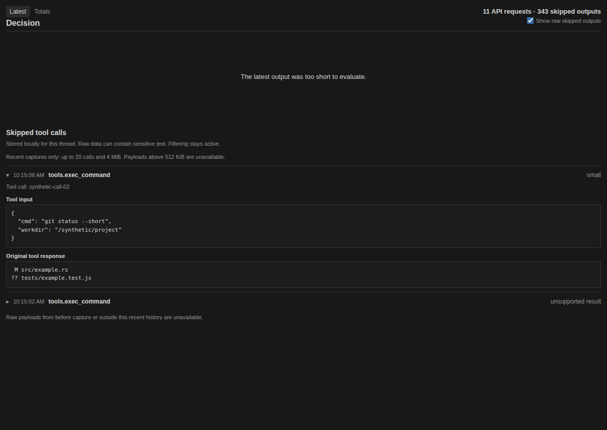
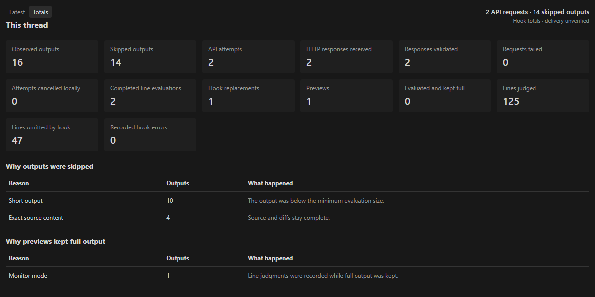

# Codex Decision



Codex Decision selects repetitive lines for removal from supported local tool output. Errors and useful evidence stay visible. Every shortened result links to the complete original.

**Codex Decision 0.15.0** — [Download the integrated VSIX](https://github.com/PhilippElhaus/Codex-Decision/releases/latest).

## Get started

Install the downloaded VSIX in **Visual Studio Code**. Open **Extensions** (`Ctrl+Shift+X`), select **… → Install from VSIX…**, and choose `codex-decision-0.15.0.vsix`. If double-clicking the file opens **Visual Studio VSIX Installer**, close that installer and use the VS Code menu.

You can also install it from a terminal:

```bash
code --install-extension codex-decision-0.15.0.vsix --force
```

The package contains native Windows and Linux x86_64 hooks, the skill, session controls, settings, and a verified Codex UI patch. It follows Codex’s Windows/WSL execution setting. Native Windows needs no WSL or Python installation. On activation it installs or updates the local plugin and repairs supported Codex builds. Existing plugin data and thread choices remain in place. Run **Developer: Reload Window** after the integration repair, then open your Codex thread. Review the hook in `/hooks` if Codex requests trust. No second package or manual composer patch is needed.

Use **Decision: Check Integration** for status and **Decision: Repair Integration** to restore the controls and reopen a hidden Decision panel. Unsupported Codex builds produce a visible diagnostic. See [installation and upgrades](docs/setup/setup_installation.md) for details and standalone CLI setup.

Temporary installer or WSL access failures retry automatically after 2, 5, and 15 seconds. Persistent failures identify the installation phase without exposing private process output. Configuration and security refusals remain visible immediately.

### 1. Connect Decision

Sign in to Codex, select **OpenAI Decisions**, **TypeSafe Jev**, or **Custom provider**, then test and save the connection in **Connect Decision**. The credentials stay out of chat.

Save a separate key for each provider and switch without entering it again. Decision settings show both saved-key states. Enable **Use the other provider if needed** for one automatic fallback when the primary key is missing or a provider request fails. Fallback is off by default; enabling it permits eligible output to reach either provider. Failed evaluations keep the full output.

For a custom provider, choose the **OpenAI Decisions** or **TypeSafe Jev** JSON schema and enter the complete endpoint URL and model ID. Authentication supports a bearer API key, username and password, a named API-key header, or no authentication. HTTPS is required except for a local loopback endpoint. The provider must implement the selected decision schema. A standard chat-completions endpoint needs a compatible adapter. Custom connections use only their configured endpoint and do not use automatic fallback.





### 2. Turn Decision on or off

Click **decision** in the composer. Each thread remembers its choice. Eligible output is sent to the selected provider while Decision is enabled.



The enabled indicator reflects API and hook health: green when healthy, red for a failure, and amber while checking or waiting for hook verification. Its tooltip and the Decision panel share the active thread's request counts, skipped-output counts, and latest hook outcome. A newer normal skip clears an older error. Codex dropdown menus cover the indicator.



### 3. Adjust the details

Open **Codex settings → Decision** to choose **Monitor** (keep full output) or **Filter** (shorten approved output). Manage the relevance cutoff, API key, and log retention here. Settings apply to all sessions.



### 4. Inspect a result

Open the **Decision** panel beside **Terminal** and **Output**. Blue rows mark proposed omissions; gold rows mark kept lines. Bars show relevance. Hover for excerpts and reasons. The latest hook status stays visible alongside the last line evaluation, so a later skip does not make an older evaluation appear current.



Select **Latest** for the current result or **Totals** for the selected thread’s saved request attempts, validated responses, evaluations, removals, and skip reasons. Switching threads restores their own counters. Incomplete older history shows a lower bound (`≥`) or an unknown count (`—`).

Use **Show skipped output** to capture future skips. You can change it before you open a thread. This sets the default for new threads; each thread keeps its own choice. Expand an entry to see the tool input and full response. Hover over the info button for storage details. Each new raw result stays visible for at least three seconds. Later results wait in a queue. When work ends, the panel shows a long remaining queue together. Click or focus an entry to pause live updates while you inspect it. Select **Resume live** to continue. Capture and its queue stay local, with a limit of 20 calls and 4 MiB. Older queued captures can expire while inspection is paused. Turn the switch off to stop capture.





Screenshots capture the current webview code with synthetic, key-free data. Code-mode scripts can still serialize the original tool result after a hook records a replacement, so the panel’s removal counts do not establish downstream token savings. See the [processing investigation](docs/development/processing_recovery_2026-10-08.md) and [troubleshooting](docs/setup/setup_installation.md).

The [October 18 investigation](docs/development/participation_evaluation_2026-10-18.md) bounds historical API participation at **8.04–8.44% of enabled invocations**. Small outputs and exact source reads account for about 61%. [Version 0.13.0](docs/development/coverage_release_0.13.0.md) fixes 11 missed safe opportunities through validated wrappers, narrower diagnostic matching, and reviewed read-only routes. The paired synthetic cohort improved from **9/20 to 20/20 safe outputs evaluated**, with no labeled evidence loss. A separate classifier holdout still kept all unknown formats. These tests do not predict the new workload rate. The UI labels hook estimates and unverified delivery explicitly.

## Documentation

[API key](docs/setup/setup_credentials.md) · [Filtering rules](docs/architecture/design_integrations.md) · [Privacy and safeguards](docs/architecture/design_data.md) · [Tests](tests/README.md) · [Windows and WSL verification](docs/development/windows_wsl_0.15.0.md) · [Startup and UI verification](docs/development/startup_ui_repair_2026-10-17.md) · [Request reliability audit](docs/development/reliability_audit_2026-10-08.md) · [Usage verification](docs/development/usage_optimization_2026-10-05.md) · [Provider benchmarks](docs/development/provider_benchmarks_2026-10-07.md)
