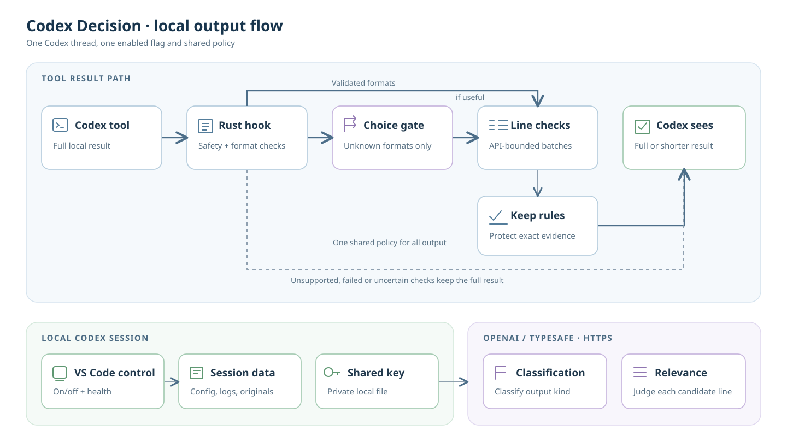

# Application architecture

Decision is a local Codex plugin with an integrated VS Code companion. It evaluates supported PostToolUse results. A provider supplies typed judgments. Local code owns routing, safeguards, thresholds, storage, and publication.

| Component | Responsibility | Source |
| --- | --- | --- |
| Hook | Decode input, select configuration, protect output, evaluate, and publish | [decision-hook](../../rust/decision/src/bin/decision-hook.rs) |
| Shared Rust library | Provider schemas, packing, protection, strict JSON, and accounting | [library](../../rust/decision/src/lib.rs) |
| CLI | Credentials, health, quality replay, versions, and UI patch lifecycle | [decisionctl](../../rust/decision/src/bin/decisionctl.rs) |
| Advisory service | Context ranking, failure triage, structured inputs, and completion checks | [advisory architecture](assistance.md) |
| Extension host | Bootstrap, runtime selection, settings, polling, panel, and updates | [extension](../../vscode-control/extension.js) |
| Host and route bridges | Connect the reviewed Codex host to Decision commands and thread state | [patch assets](../../vscode-control/patch-assets) |
| Webviews | Composer, settings, latest decision, and totals | [webview scripts](../../vscode-control/webview) |
| Installers | Preserve registration identity, plugin data, and recorded hook paths | [native installer](../../vscode-control/install-plugin-native.js), [WSL installer](../../vscode-control/install-plugin.py) |
| Packaging | Stage an exact allowlist and verify bytes, versions, and binary targets | [package verifier](../../scripts/verify_packages.py) |

The hook selects the thread data directory and reads shared settings. Local guards reject unsafe or unsuitable input. Known independent-line formats proceed to relevance evaluation. Unknown formats first pass a classification gate. The packer sends complete targets in bounded batches. Answers must pass schema, identity, model, and probability checks.

Monitor records a preview. Filter can publish shortened feedback only after the savings checks and exact-original writes succeed. Publication uses a bounded private transaction. A failed evaluation keeps the complete result. See [filtering](../reference/filtering.md), [provider adapters](providers.md), and [storage](storage.md).

The companion selects the same thread through a reviewed internal route bridge. It reads private thread records and sends settings and toggle commands. This integration depends on hash-pinned Codex assets. See [VS Code integration](vscode.md).

Windows and WSL are separate runtimes. Each has its own registration, data, settings, and credentials. The VSIX contains both x86_64 runtimes. Native Windows uses the VS Code Node host. WSL installation uses Python.

