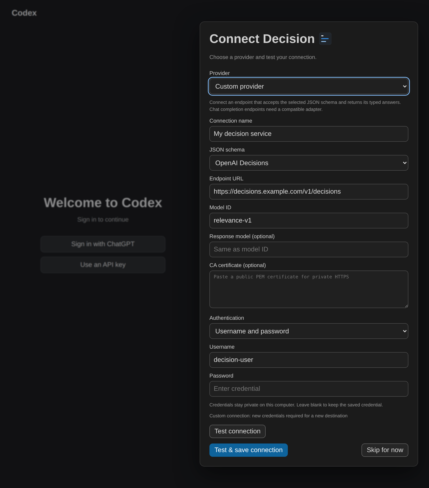
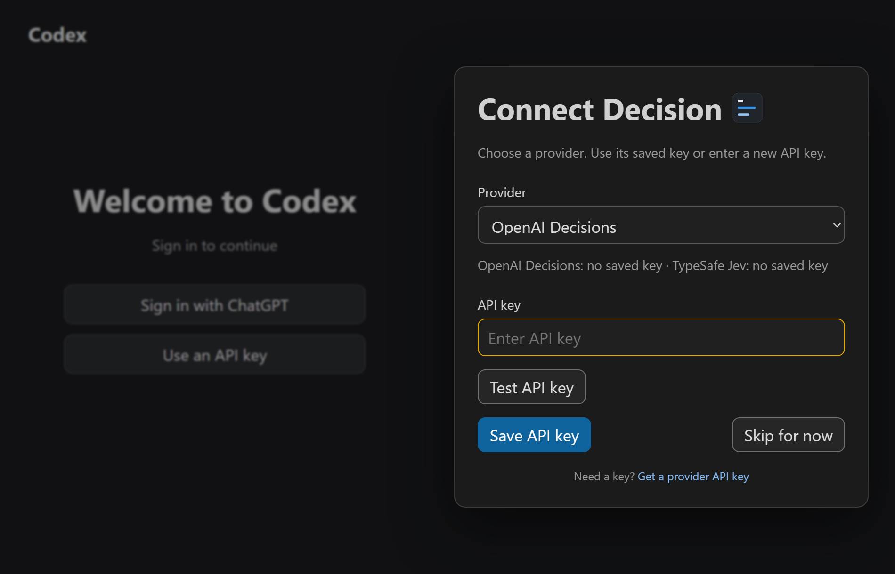
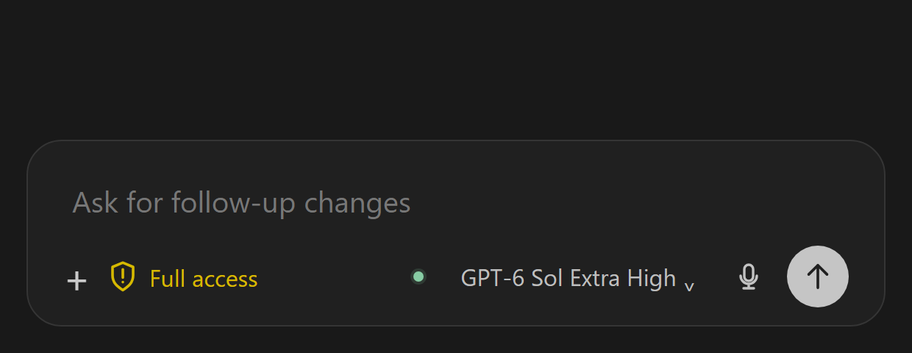
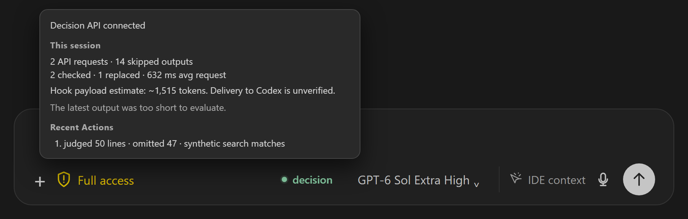
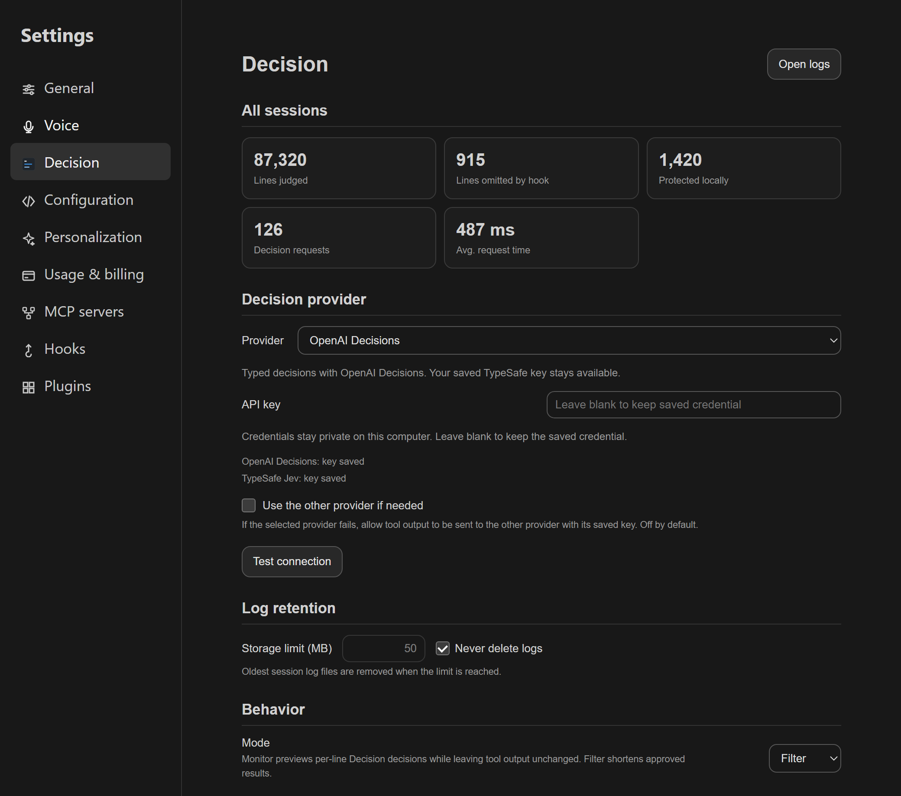
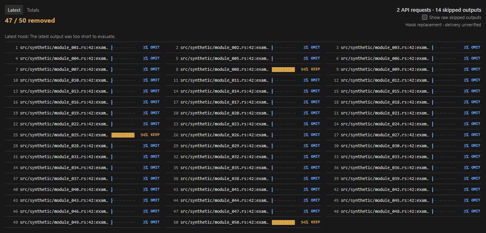
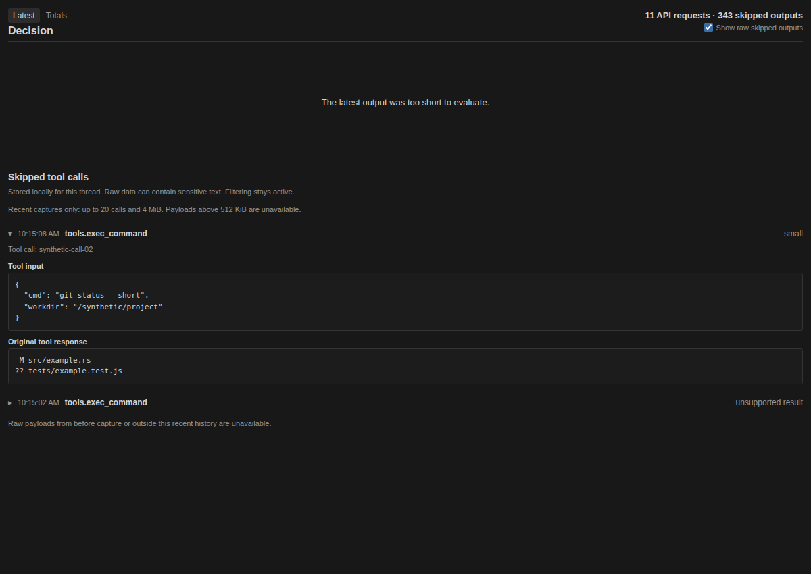
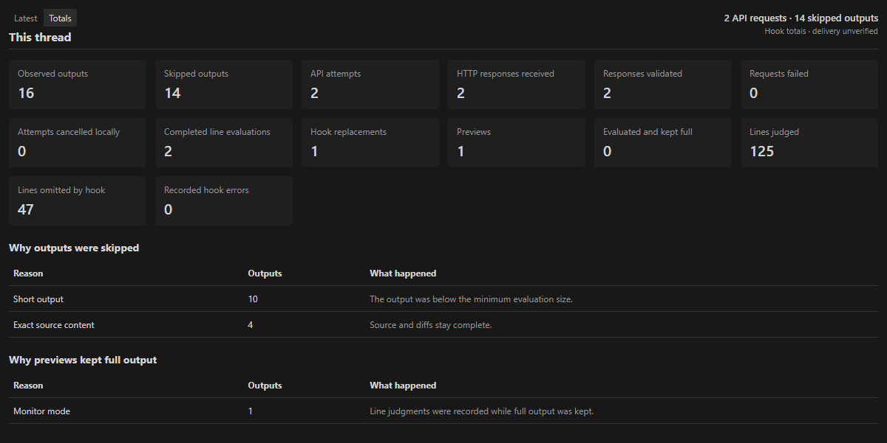

# Use Decision in VS Code

Install the integrated VSIX and complete [provider setup](../setup/providers.md) first.

## 1. Connect Decision

Sign in to Codex, select **OpenAI Decisions**, **TypeSafe Jev**, or **Custom provider**, then test and save the connection in **Connect Decision**. The credentials stay out of chat.

Save a separate key for each provider and switch without entering it again. Decision settings show both saved-key states. Enable **Use the other provider if needed** for one automatic fallback when the primary key is missing or a provider request fails. Fallback is off by default; enabling it permits eligible output to reach either provider. Failed evaluations keep the full output.

For a custom provider, choose the **OpenAI Decisions** or **TypeSafe Jev** JSON schema and enter the complete endpoint URL and model ID. Authentication supports a bearer API key, username and password, a named API-key header, or no authentication. HTTPS is required except for a local loopback endpoint. The provider must implement the selected decision schema. A standard chat-completions endpoint needs a compatible adapter. Custom connections use only their configured endpoint and do not use automatic fallback.

Custom connections can specify an exact response model when the server resolves an alias, and a public CA certificate for private HTTPS. See the [provider setup](../setup/providers.md#model-aliases-and-private-https).

## 2. Turn Decision on or off

Click **decision** in the composer. Each thread remembers its choice. Eligible output is sent to the selected provider while Decision is enabled.

The enabled indicator reflects API and hook health: green when healthy, red for a failure, and amber while checking or waiting for hook verification. Its tooltip and the Decision panel share the active thread's request counts, skipped-output counts, and latest hook outcome. A newer normal skip clears an older error. Codex dropdown menus cover the indicator.

## 3. Adjust the details

Open **Codex settings → Decision** to choose **Monitor** (keep full output) or **Filter** (shorten approved output). Manage the relevance cutoff, API key, and log retention here. Settings apply to all sessions.

## 4. Inspect a result

Open the **Decision** panel beside **Terminal** and **Output**. Blue rows mark proposed omissions; gold rows mark kept lines. Bars show relevance. Hover for excerpts and reasons. The latest hook status stays visible alongside the last line evaluation, so a later skip does not make an older evaluation appear current.

Select **Latest** for the current result or **Totals** for the selected thread’s saved request attempts, validated responses, evaluations, removals, and skip reasons. Switching threads restores their own counters. Incomplete older history shows a lower bound (`≥`) or an unknown count (`—`).

Use **Show skipped output** to capture future skips. You can change it before you open a thread. This sets the default for new threads; each thread keeps its own choice. Expand an entry to see the tool input and full response. Hover over the info button for storage details. Each new raw result stays visible for at least three seconds. Later results wait in a queue. When work ends, the panel shows a long remaining queue together. Click or focus an entry to pause live updates while you inspect it. Select **Resume live** to continue. Capture and its queue stay local, with a limit of 20 calls and 4 MiB. Older queued captures can expire while inspection is paused. Turn the switch off to stop capture.

Screenshots use synthetic, key-free data. Panel removals describe prepared hook output. See [measurement](../operations/measurement.md) for delivery limits.
